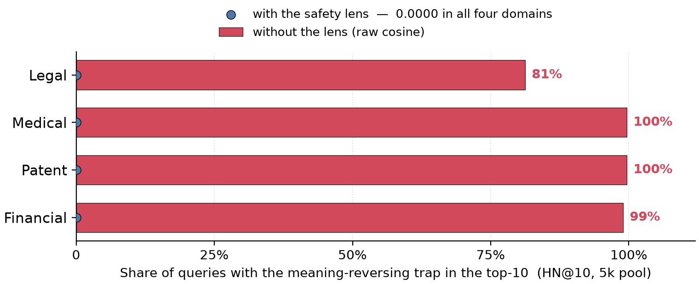
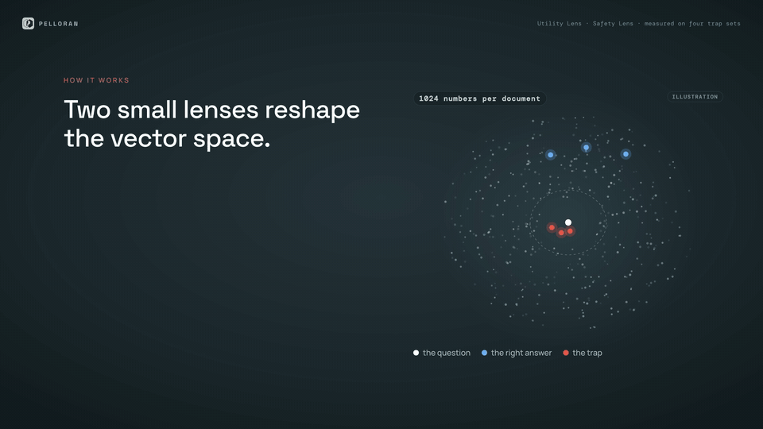

<div align="center">

# pelloran-safety-lens

### A small learned projection that keeps meaning-reversing traps out of the top ten for the cases it was trained on, measured in four domains.

<p>
  <a href="LICENSE"></a>
  <a href="https://github.com/pelloran-inc/pelloran-safety-lens/actions/workflows/tests.yml"></a>
  <a href="REPRODUCE.md"></a>
  <a href="REPRODUCE.md"></a>
  <!-- <a href="https://arxiv.org/abs/XXXX.XXXXX"></a> -->
  <a href="https://doi.org/10.5281/zenodo.24345474"></a>
</p>

**Clone it, rebuild the pools, check the hashes.**

</div>

---

<div align="center">
  
  <br>
  <sub><b>The result in one picture.</b> Without the lens, a meaning-reversing trap reaches the top-10 for <b>81&ndash;100&thinsp;%</b> of queries (raw cosine over E5-Large-v2). With a small learned <b>safety lens</b> &mdash; 11 or 32 numbers per document &mdash; it is <b>0.0000</b> in all four domains, under exact nearest-neighbour search. Every number here is re-measured by the package (<a href="REPRODUCE.md">REPRODUCE.md</a>).</sub>
</div>

<div align="center">
  
  <br>
  <sub><b>How it works, in 15 seconds</b> (an illustration, sped up). Two small learned lenses reshape the vector space: the <b>Utility Lens</b> pulls together what belongs together, the <b>Safety Lens</b> pushes away what only looks alike, and the space shrinks from 1024 numbers per document to 11 or 32. The lenses are applied once; the small copy goes into any vector database. <a href="assets/pelloran_safety-lens_what-it-does.webm">The whole video (4:34)</a>.</sub>
</div>

---

The reproducibility package for the paper **"Small Learned Projections for Semantic-Reversal-Aware Retrieval with Spectral Acceleration: A Four-Domain Empirical Study"** by Sayed Amir Karim (Pelloran Research).

## The problem, in one example

A search system built on sentence embeddings is asked about a clause **A**:

- **A**: *"A circuit board comprising a processor, a memory chip, and a display driver."*
- **B**, a trap, changes one word and so reverses the meaning: *"A circuit board **consisting of** a processor, a memory chip, and a display driver."*
- **C** says the same as A in other words: *"A circuit board including a processor, a memory chip, and a display driver on it."*

Measured by plain cosine similarity, B sits so close to A that it often lands among the top ten results. The paper trains a small linear projection, a **safety lens**, that keeps C close to A and pushes traps like B out of the top ten. It does this in four domains: legal, medical, patent and financial text.

## What is in this package

| Folder | Contents |
|:---|:---|
| `data/traps/` | The four trap sets (A/B/C triples): legal 299, medical 300, patent 301, financial 301. `medical_base_100.json` is the hand-written base of the medical set. |
| `lenses/` | The five safety lenses the paper measures: Legal (d = 11), Legal (d = 32, the ablation), Medical, Patent and Financial (d = 32 each), plus `legal_improved_d11` — the phrasing-robust Legal lens of §Robustness. |
| `results/` | The stored measurements behind the paper's tables: pool sizes, raw cosine without a lens (`raw_cosine/`, Cell A), the cross-domain matrix, the ablation, and the v0.16 additions (`baselines/`, `robustness/`). |
| `scripts/` | Trap generators and curation, distractor pool builders, embedding and packing, the duplicate check, the lens trainer, the measurement, and the tools below. |
| `tests/` | Integrity checks that need no model and no download. |

`lenses/SHA256SUMS` and `data/SHA256SUMS` hold the SHA-256 of every lens and trap set.

## How the measurement works

`scripts/miss_diagnostic.py` projects every query and every pool row through a lens and ranks the whole pool by exact inner product. No approximate index is involved. With `--raw` instead of `--lens` it ranks by raw cosine on the E5 vectors themselves, the baseline without a lens. For each query it records where the trap B and the paraphrase C rank:

- **HN@10**: the share of queries whose trap B is in the top ten. Lower is better.
- **HitC@10**: the share of queries whose paraphrase C is in the top ten. Higher is better.

A pool is one domain's trap set (each case adds A, B and C) plus 5 000, 50 000 or about 100 000 distractor clauses from public text of the same domain. Pools are stored as AQTC binaries:
- a 20-byte header (`AQTC`, version, dimension, number of cases, number of distractors);
- the A/B/C embeddings, case by case;
- the distractor embeddings.

## Check the stored results

```
python3 -m unittest discover -s tests          # integrity: hashes, references, self-consistency (seconds)
python3 scripts/check_results.py --aqtc-dir DIR
```

`check_results.py` re-runs the measurement for every stored result whose pool binary is in `DIR`, named `<domain>_<size>.aqtc`, for example `legal_5k.aqtc`. The numbers must be equal, not close. Every command, the hashes to check against and the expected output are in [`REPRODUCE.md`](REPRODUCE.md).

`scripts/run_matrix.py --aqtc-dir DIR --out-dir OUT` measures every lens on every pool in `DIR`: the cross-domain check. A lens is declared for its own domain's cases. On another domain it transfers only partly: it lowers HN@10 below raw cosine but does not reach 0.

## The pipeline

These steps follow the paper's reproducibility protocol (§7.4):

1. **Trap sets.** `gen_patent_triples_300.py` and `gen_financial_triples_300.py` write their sets. `gen_medical_triples_200.py` adds 200 triples to the medical base. `curate_*` rewrite paraphrases that a first lens missed. `gen_legal_triples.py` generates the legal trap family, and `dedup_trap_set.py` removes duplicate triples. The shipped sets in `data/traps/` are the ones the paper measures.
2. **Distractor pools.** `build_patent_distractor_pool.py` (BIGPATENT), `build_financial_distractor_pool.py` (five Hugging Face financial datasets) and `build_legal_distractor_pool.py` (LexGLUE and others) download public text and keep short clauses, about 8 to 30 words. The medical pool (short clauses from PubMed abstracts) has no builder script in this release. The pools are not redistributed here; see `DATA.md`.
3. **Embedding.** `embed_and_pack.py --triples … --distractor-pool … --out-dir … --name <domain>` embeds with `intfloat/e5-large-v2` (no prefix, L2-normalised) and writes the AQTC binaries at 5k, 50k and 100k.
4. **Duplicate check.** `preflight_dedup_check.py --embeddings … --dataset …` refuses a set in which 5 % or more of the cases are byte-identical duplicates.
5. **Training.** `steering_lens_train.py --embeddings … --dataset … --out-aqwt … --compressed-dim 32 --beta-hardneg 15 --margin 0.10 --seed 42`, then a second, warm-started round (`--init-aqwt`) if HN@10 is not yet 0.
6. **Measurement.** `miss_diagnostic.py` on the pool sizes (`--raw` for the baseline without a lens), and `run_matrix.py` against the other domains.

Requirements: Python 3.10 or later and `numpy` for measuring; `torch` for training; `sentence-transformers` for embedding; `datasets` for the pools. See `pyproject.toml`.

## Not in this package

The paper's wall-clock figures use a proprietary retriever of Pelloran's that works on the projected embeddings. It is not part of this package and not needed for any quality number here: the measurement above is exact search.

## Citation

If you use this package, please cite the paper:

> Sayed Amir Karim. *Small Learned Projections for Semantic-Reversal-Aware Retrieval with Spectral Acceleration: A Four-Domain Empirical Study.* Preprint, 2026. doi:[10.5281/zenodo.24345474](https://doi.org/10.5281/zenodo.24345474)

```bibtex
@misc{karim2026safetylens,
  author = {Karim, Sayed Amir},
  title  = {Small Learned Projections for Semantic-Reversal-Aware Retrieval with Spectral Acceleration: A Four-Domain Empirical Study},
  year   = {2026},
  note   = {Preprint},
  doi    = {10.5281/zenodo.24345474}
}
```

GitHub's "Cite this repository" button gives the same reference, from [`CITATION.cff`](CITATION.cff). Each release's changes are listed in [`CHANGELOG.md`](CHANGELOG.md).

## Licence

Copyright © 2026 Pelloran Inc.

This package is free software under the **GNU Affero General Public License v3.0** (`LICENSE`). Anyone may use, study, change and share it. If you offer a changed version to others, including over a network, you must offer them its source code under the same licence.

If you want to use it under other terms, Pelloran offers a commercial licence; see `COMMERCIAL.md`. What is and is not included, and under whose terms: `NOTICE` and `DATA.md`. Contributions: `CONTRIBUTING.md` (not open yet).

Contact: opensource@pelloran.com
